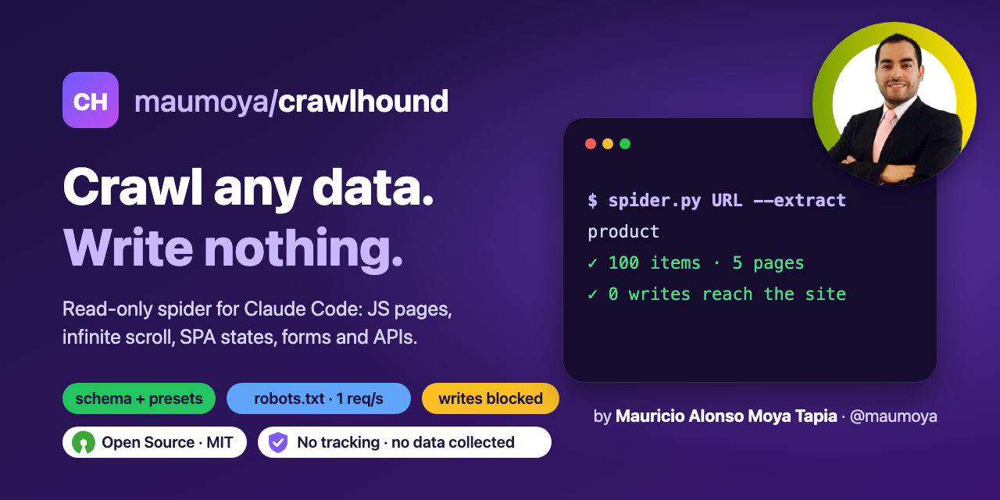
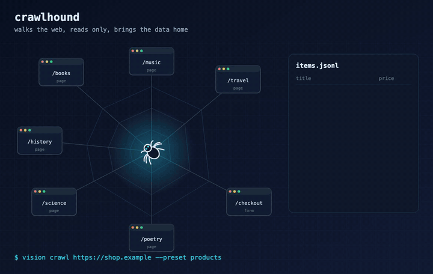

<!-- Regenerate the row with badges.sh: it adds Scorecard, Best Practices and measured benefit badges when they exist. -->
<p align="center"></p>

<p align="center">
  
  
  <a href="https://opensource.org/license/mit"></a>
  
  <a href="https://scorecard.dev/viewer/?uri=github.com/maumoya/crawlhound"></a>
  <a href="https://www.bestpractices.dev/projects/16516"></a>
</p>

<p align="center"><a href="#results-measured-2026-11-09"></a></p>

<p align="center"></p>

# Crawlhound

**Tell Claude what data you want from a site. You get it as JSON lines, plus a map of every page, SPA state, form and
API, and no write ever reaches the site.**

A read-only web spider for Claude Code. You say what to collect in plain English ("every quote with its author and
tags"); Claude writes a small JSON schema (or picks a preset), and `spider.py` crawls one origin in headless Chrome,
including JavaScript pages, infinite scroll and SPA states that only a click reaches.

## Install

Claude Code plugin:

```
/plugin marketplace add maumoya/crawlhound
/plugin install crawlhound@crawlhound
```

Any agent that reads skills:

```
npx skills add maumoya/crawlhound
```

Needs Python 3.9+ and an installed Chrome or Chromium. No pip packages.

## Use

Type `/crawlhound` or just ask:

- "Crawl quotes.toscrape.com/js and get every quote, author and tags."
- "Extract the products and prices from my shop at localhost:3000."
- "Map my app's pages, routes, forms and APIs."

Or run the script yourself:

```
python3 skills/crawlhound/scripts/spider.py https://quotes.toscrape.com/js/ \
  --extract schema.json --include '/js/(page/[0-9]+/)?$' --terms-ok
```

Output goes to `./site-maps/<host>-<time>/`: `items.jsonl` (your data), `map.json` and `map.md` (pages, SPA states,
routes, forms, GET APIs, blocked writes, coverage verdict).

### In CI (GitHub Action)

Crawl your preview or a local server in a workflow and fail the job when pages or items fall short:

```yaml
- uses: maumoya/crawlhound@v0.3.0
  with:
    url: http://127.0.0.1:8000/   # a server you started earlier in the job
    extract: product              # optional preset or schema file
    min-pages: 5
    min-items: 1
```

Outputs `pages` and `items`; the full map goes to the job summary. Off loopback, set `terms-ok: true` only for a site
you own or whose terms allow crawling.

### Say what to collect

| Way | Flag | When |
|---|---|---|
| Preset | `--extract text` · `tables` · `links` · `prices` · `product` · `article` | the ask fits a common shape |
| Schema file | `--extract schema.json` (check it with `--check-schema`) | anything else: item selector and named fields, `attr`, `all`, `regex`, `type: number`, `match` |

A schema is a few lines ([format](skills/crawlhound/references/schema.md)):

```json
{"name": "quotes", "item": ".quote",
 "fields": {"text": {"css": ".text"}, "author": {"css": ".author"}, "tags": {"css": ".tag", "all": true}}}
```

There is no contacts preset, on purpose: the skill refuses to harvest emails, phone numbers or names of private people.

### Guard rails (enforced in code, not only in the prompt)

- **Read-only:** every non-GET/HEAD request is failed inside the browser and listed in `blocked_requests`.
- **Polite:** robots.txt (RFC 9309, Crawl-delay honoured) and 1 request per second; `--delay` cannot go lower off loopback.
- **Consent:** any host other than loopback needs `--terms-ok`, which Claude passes only after you confirm you own
  the site or its terms allow crawling. A built-in deny-list (stored as hashes) is refused even with `--terms-ok`.
- **No bulk downloads:** images, media and fonts are not fetched unless `--load-media` is set for pages that need them to render.

## Results (measured 2026-11-09)

Same 4 targets for every tool, scored against hand-made ground truth by `bench/score.py`:
a loopback fixture (JavaScript products, infinite scroll, SPA tabs, a form and a tracking POST) and three public
sandboxes built for scraping practice (quotes.toscrape.com `/js/` and `/scroll`, books.toscrape.com, first 5 pages).

| Tool | Items found (recall), 4 targets | Field accuracy | SPA states mapped | Writes reaching the fixture | robots.txt violations | Time, quotes-js |
|---|---|---|---|---|---|---|
| **crawlhound** | **100% · 100% · 100% · 100%** | 100% | **yes (13 on the fixture)** | **0** | **0** | 1135 s |
| Crawlee 3.13 | 100% · 100% · 100% · 100% | 100% | no | 0 | 0 | 19 s |
| Crawl4AI 0.6.3 | 100% · 100% · 100% · 20% | 100% | no | 0 | 0 | 33 s |
| Scrapy 2.13 | 0% · 0% · 0% · 100% (no JavaScript) | 100% where found | no | 0 | 0 | 14 s |
| Katana 1.1.3 | mapping only, no extraction | n/a | no | 0 | **1** | 42 s |
| Firecrawl (hosted) | not run · 40% · 10% · 100% | 62–100% | no | not run (cannot reach loopback) | — | 34 s |

What this shows, honestly:

- **Accuracy:** crawlhound and Crawlee both found every item with every field right on all 4 targets.
- **Where crawlhound is different:** it is the only tool that maps SPA states (clicks that change the page without a
  link) and lists the write requests it blocked. Writes and robots.txt are measured on the fixture only, where the
  server logs every request.
- **Where it loses:** speed. It clicks every button and tab and waits 1 second between requests, so the 10-page
  quotes-js crawl took 19 minutes against Crawlee's 19 seconds. Use `--no-click` when links reach every page.
- Firecrawl ran with depth 3 (two deeper runs timed out), so its quotes numbers understate it.

Full table (pages, forms, GET APIs, timings per target): [bench/results/RESULTS.md](bench/results/RESULTS.md).
Versions, pinned images and why Browsertrix was not run: [bench/ADMISSION.md](bench/ADMISSION.md).
Reproduce with `bench/run.sh --build` (needs Docker and Playwright).

## How it is tested

- `tests/test_spider.py` (25 tests): robots.txt matching, the write guard, the deny-list, schema checks, presets,
  and full crawls of a loopback fixture (JavaScript products, infinite scroll, SPA states).
- `evals/`: one case per promise. Run `claude plugin eval . --allow-tools`.
- `tests/fuzz/fuzz_parsers.py`: Atheris fuzzing of the robots.txt, WebSocket frame, URL and schema parsers (60 s per PR).
- `.github/workflows/action-selftest.yml`: the GitHub Action runs on the fixture site, once to pass and once to fail.
- `bench/`: the head-to-head benchmark above. Every PR runs `scripts/lint_skill.sh` in CI.

## FAQ

### Does it log in or fill forms?

No. It never types credentials or submits forms, and writes are blocked in the browser. Forms are listed in the map, never sent.

### Can it crawl any website?

Only sites you own or whose terms allow crawling, and only what robots.txt allows. Off loopback it will not run
without `--terms-ok`.

### Why is it slower than Crawlee or Crawl4AI?

It clicks every button and tab to find SPA states that links never reach, and it waits 1 second between requests.
Use `--no-click` when links alone reach every page.

### Does it send my data anywhere?

No. It is instructions and local scripts; the only network traffic is the crawl itself.

## About the author

Hi, I'm **Mauricio Alonso Moya Tapia** ([@maumoya](https://github.com/maumoya)). I built crawlhound for VISION,
my own agent framework, to see every page, state and API of a web app and pull its data without changing anything.

Say hi or follow my work on [GitHub](https://github.com/maumoya).

## License

MIT © 2026 Mauricio Alonso Moya Tapia
